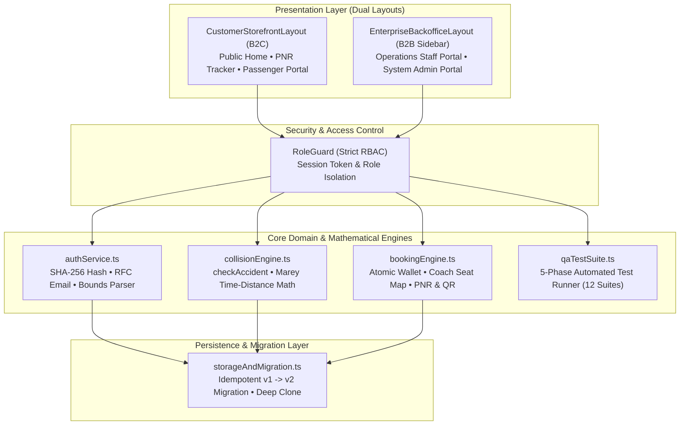

# RailPulse Enterprise | پلتفرم جامع رزرواسیون بلیط و فرماندهی عملیات ریلی

[](./LICENSE)
[](https://www.typescriptlang.org/)
[](https://react.dev/)
[](https://tailwindcss.com/)

**RailPulse Enterprise** is a production-grade, bilingual (Persian RTL / English LTR) railway reservation, corridor topology, and temporal-spatial collision prevention platform. Originally re-engineered from a legacy Python CLI prototype (`Mahdias1383/management_system`), RailPulse transforms volatile in-memory dictionaries into an enterprise multi-portal web architecture with strict Role-Based Access Control (`RoleGuard`), dual B2C/B2B layouts, visual coach seat selection, and a mathematical train dispatch safety engine.

---

## System Architecture Overview



---

## Feature Matrix by Portal

| Portal / Workspace | Target Role | Layout System | Key Capabilities |
| :--- | :--- | :--- | :--- |
| **Public Travel Storefront** | Guest / Visitor | `CustomerStorefrontLayout` | Interactive Origin/Destination search engine with station swap, Live National Departures board, and instant PNR Ticket Lookup. |
| **Passenger Reservation Portal** | `passenger` | `CustomerStorefrontLayout` | Visual wagon coach seat map selector (`SeatMapSelector`), station-by-station timetable breakdown, atomic wallet funding/withdrawal, perforated digital QR boarding pass modal, and 1-click ticket cancellation & refund. |
| **Railway Operations & Dispatch** | `staff` | `EnterpriseBackofficeLayout` (Sidebar) | Corridor & intermediate station topology builder, train fleet scheduling, real-time `checkAccident` safety radar, automatic safe departure slot recommender, and interactive **Marey Time-Distance Diagram**. |
| **System Executive Backoffice** | `admin` | `EnterpriseBackofficeLayout` (Sidebar) | Executive KPIs, 30-day ticket sales revenue analytics (Recharts Area/Bar charts), Operations Staff HR directory (CRUD), immutable system audit trail, JSON snapshot backup/restore, and the **5-Phase Automated QA Suite**. |

---

## Default Seed Accounts for Local Testing & Evaluation

For security and production cleanliness, plaintext passwords are **never** displayed on the public login screen. Developers and evaluators can use the following pre-seeded accounts to test each role:

| Role | Username | Password | Pre-Seeded Context |
| :--- | :--- | :--- | :--- |
| **System Administrator** | `Admin_train` | `admin_train` | Full executive access, staff HR management, 30-day revenue charts, and 5-Phase QA test runner. |
| **Operations Staff (Engineer 1)** | `sara_ahmadi` | `staff123` | High-Speed Dispatch & Signalling department; manages corridors, train schedules, and Marey collision radar. |
| **Operations Staff (Engineer 2)** | `reza_karimi` | `staff123` | Corridor Topology & Safety department. |
| **Regular Passenger A** | `mahdi_as` | `user123` | Pre-funded wallet (`48,000,000 IRR` / `48,000,000 ریال`), confirmed VIP boarding pass (`RP-89412`) on Tehran–Mashhad HSR. |
| **Regular Passenger B** | `parisa_rad` | `user123` | Pre-funded wallet (`21,500,000 IRR` / `21,500,000 ریال`), confirmed boarding pass (`RP-90234`) on Tehran–Isfahan Express. |

---

## Quick Start & Local Development

### Prerequisites
- **Node.js** `>= 20.0.0`
- **npm** `>= 10.0.0`

### Installation & Run
```bash
# 1. Install dependencies
npm install

# 2. Start the development server on http://localhost:3000
npm run dev

# 3. Type-check with TypeScript
npm run lint

# 4. Build for production deployment
npm run build
```

---

## Built-In 5-Phase Automated Verification Suite

Log in as **System Administrator** (`Admin_train` / `admin_train`) and select **Engineering QA & Automated Tests** in the sidebar to execute 12 programmatic test suites verifying:
1. **Phase 1 — Unit Tests (`UT-01` to `UT-05`):** Positive float/integer parsing (preventing legacy Python `str < int` TypeError crashes), overdraft prevention, case-insensitive ID normalization, RFC email regex, and `checkAccident` station/segment collision formulas.
2. **Phase 2 — Integration Tests (`IT-01` to `IT-02`):** Admin staff provisioning $\to$ Staff authentication $\to$ Multi-line creation (proving zero shared array mutations) $\to$ Train dispatch $\to$ Passenger registration, wallet funding, and seat booking.
3. **Phase 3 — Migration Tests (`MT-01` to `MT-02`):** Automatic idempotent migration from legacy Python `v1` dictionaries (`user_dict`, `employee_dict`, `line_dic`, `train_dic`) to normalized `v2` entities.
4. **Phase 4 — End-to-End Tests (`E2E-01` to `E2E-02`):** Full ticket lifecycle (booking, seat assignment, QR boarding pass, and refund restoration) and safety guard blocking of colliding schedules.
5. **Phase 5 — RBAC & UI Isolation Tests (`UI-01` to `UI-03`):** Programmatic verification of `RoleGuard` route protection, multi-passenger wallet/profile isolation, and bi-directional RTL/LTR localization state.

---

## License
Distributed under the **MIT License**. See [`LICENSE`](./LICENSE) for details.
