<div align="center">

# RailPulse Enterprise

### Next-Generation Intelligent Railway Infrastructure, Operations Command & High-Speed Travel Reservation Platform
### سامانه جامع مدیریت هوشمند خطوط ریلی، مهندسی ترافیک و رزرواسیون قطارهای سریع‌السیر

[](./LICENSE)
[](https://www.typescriptlang.org/)
[](https://react.dev/)
[](https://tailwindcss.com/)
[](https://www.framer.com/motion/)
[](#accessibility--wcag-21-aa)
[](#qa-test-suite--diagnostics)

<br/>

**[English Documentation](#english-documentation)** • **[مستندات فارسی](#مستندات-فارسی)** • **[Visual Documentation](#visual-documentation--گالری-تصاویر)** • **[Quickstart](#quickstart--راه‌اندازی)**

</div>

---

# English Documentation

## Project Overview

**RailPulse Enterprise** is an enterprise-grade railway management and high-speed passenger reservation platform modeled after world-class platforms (*Trainline, Eurostar, Linear, and Stripe Dashboard*). It re-engineers a legacy Python CLI terminal prototype into a modern, production-deployable full-stack TypeScript web application with **zero mock fallbacks**, **true bidirectional localization** (Persian RTL with Iranian Rial `IRR` and English LTR with United States Dollar `USD`), and **uncompromising role-based access control (`RoleGuard`)**.

### Core Architecture
- **Dual-Layout Architecture:** Strict isolation between the public, high-conversion **Customer Storefront** (`CustomerStorefrontLayout`) and the high-density, command-driven **Enterprise Backoffice** (`EnterpriseBackofficeLayout`).
- **Mathematical Safety Dispatch Engine (`checkAccident`):** Enforces a mandatory 5-minute temporal-spatial headway safety buffer across corridor segments and station platform dwell times (20 minutes). Prevents train collisions before schedule approval and recommends the earliest safe alternate departure time.
- **Interactive Coach Seat Selection:** Visual SVG-rendered 4-column coach layout with window/aisle designations, real-time availability locks, and instant balance deduction.
- **Perforated QR Digital Boarding Pass:** Generates verifiable, print-ready passenger travel documents with unique PNR tracking codes and base64-payload QR codes.
- **Executive Analytics & Alert Center:** Dynamic Recharts 12-month and 30-day revenue visualizations with Persian numeric digits (`Vazirmatn FD`) and real-time push alerts for high-revenue bookings and headway conflicts.
- **5-Phase Programmatic Test Suite:** Comprehensive built-in test runner located strictly inside the administrator backoffice, validating Unit calculations, Integration workflows, Data Migration, End-to-End journeys, and RBAC boundary isolation.

---

## Key Features

| Domain | Technical Highlights & Capabilities |
| :--- | :--- |
| **Dual-Layout UX** | Separate layouts for public storefront (`CustomerStorefrontLayout`) and backoffice workspace (`EnterpriseBackofficeLayout`). |
| **Bilingual Localization** | Full bi-directional support: Persian (RTL, `IRR`, `Vazirmatn FD`) and English (LTR, `USD`, `Plus Jakarta Sans`). |
| **Collision Prevention Engine** | Real-time calculation of station platform overlaps and segment headway conflicts with automatic safe slot recommendation. |
| **Seat Map & Digital Boarding Pass** | Interactive coach seat selector (window/aisle) and verifiable QR digital boarding pass with PNR tracking. |
| **Digital Wallet Ledger** | Atomic wallet deposit, withdrawal, ticket purchase, and instant full refund restoration on cancellation. |
| **Executive Analytics** | Recharts 12-month and 30-day revenue analytics, KPI stat cards with spring animations, and real-time notification bus. |
| **Security & RBAC** | Strict `RoleGuard` enforcement, SHA-256 password hashing, token validation, and zero credentials displayed on public pages. |
| **5-Phase QA Suite** | Programmatic test runner covering Unit, Integration, Migration, E2E, and RBAC isolation tests. |

---

# مستندات فارسی

## معرفی جامع پروژه

**سامانه ریل‌پالس اینترپرایز (RailPulse Enterprise)** یک پلتفرم جامع سازمانی، مدرن و دومنظوره برای مدیریت یکپارچه خطوط ریلی، برنامه‌ریزی ناوگان قطارهای سریع‌السیر و رزرواسیون آنلاین بلیط است. این پروژه بر اساس استانداردهای مهندسی برترین سامانه‌های حمل‌ونقل و رزرو بین‌المللی طراحی شده و سامانه‌ای منسوخ و مبتنی بر خط فرمان پایتون را به یک وب‌اپلیکیشن تمام‌عیار، واکنش‌گرا و قابل‌استقرار در محیط پروداکشن تبدیل کرده است.

### ارکان بنیادین سامانه
- **معماری رابط کاربری دومحیطه (Dual-Layout):** جداسازی کامل و بدون تداخل محیط مسافرتی و فروشگاهی (`CustomerStorefrontLayout`) از پنل عملیاتی و متراکم مدیریت و ناوبری (`EnterpriseBackofficeLayout`).
- **موتور ریاضی رادار ضدبرخورد و پایش تداخل (`checkAccident`):** پایش پیوسته زمان‌بندی قطارهای هر کریدور، محاسبه زمان سیر با سرعت مجاز، توقف ۲۰ دقیقه‌ای در ایستگاه‌های میانی، رعایت سرفاصله ایمنی ۵ دقیقه‌ای و پیشنهاد خودکار نزدیک‌ترین اسلات خالی و ایمن برای حرکت.
- **انتخاب صندلی بر روی نقشه شماتیک واگن:** انتخاب بصری صندلی (کنار پنجره یا راهرو) با ثبت قطعی و کسر اتمیک مبلغ از کیف پول کاربر.
- **صدور کارت سوارشدن دیجیتال با بارکد QR:** تولید کد رزرو یکتای ۵ رقمی (PNR) و کارت سوارشدن رسمی با قابلیت چاپ و اعتبارسنجی آفلاین.
- **داشبورد تحلیلی ۱۲ ماهه و مرکز هشدار بلادرنگ:** نمودارهای پیشرفته Recharts برای پایش روند درآمد ۱۲ ماهه و ۳۰ روزه با فونت فارسی `وزیرمتن` و پایپ‌لاین نوتیفیکیشن بلادرنگ.
- **مجموعه تست خودکار ۵ مرحله‌ای مهندسی:** تعبیه کامل تست‌رانر داخلی در سایدبار مدیریت ارشد جهت راستی‌آزمایی تست‌های واحد، یکپارچگی، مهاجرت داده `v1` به `v2`، سناریوهای سرتاسری و مرزبندی نقش‌ها (`RoleGuard`).

---

## قابلیت‌های کلیدی سیستم

| محور تخصصی | شرح قابلیت‌ها و دستاوردهای مهندسی |
| :--- | :--- |
| **معماری رابط کاربری دوگانه** | تفکیک کامل پورتال فروشگاهی مسافران از محیط داشبورد عملیاتی و مانیتورینگ کارشناسان. |
| **بومی‌سازی دوزبانه استاندارد** | پشتیبانی هم‌زمان از تقویم، واحد پولی (ریال و دلار) و جهت چیدمان (فارسی راست‌به‌چپ و انگلیسی چپ‌به‌راست). |
| **رادار ایمنی و پیشگیری از برخورد** | محاسبه ریاضی تداخل سکوی ایستگاه و سبقت روی بلاک میانی و ارائه پیشنهاد هوشمند زمان ایمن. |
| **نقشه صندلی و کارت پرواز قطار** | شبیه‌سازی گرافیکی کوپه و صندلی‌ها و صدور آنی کارت سوارشدن QR با بارکد رمزنگاری‌شده. |
| **کیف پول دیجیتال اتمیک** | مدیریت تراکنش‌های مالی، شارژ موجودی، برداشت، پرداخت بلیت و استرداد آنی و کامل وجه در صورت انصراف. |
| **تحلیل داده و شاخص‌های مدیریتی** | پایش شاخص‌های درآمدی، نمودار مساحتی فروش ۱۲ ماهه و مرکز اعلانات زنده رویدادهای بحرانی. |
| **امنیت و تفکیک سطوح دسترسی** | کنترل دقیق دسترسی مبتنی بر نقش (`RoleGuard`)، رمزنگاری کلمات عبور با `SHA-256` و عدم نمایش اعتبارنامه‌ها در صفحات عمومی. |
| **مرکز آزمون و تضمین کیفیت خودکار** | اجرای زنده آزمون‌های مهندسی ۵ مرحله‌ای با لاگ دقیق متدها و گزارش سلامت ۱۰۰ درصدی. |

---

# Visual Documentation / گالری تصاویر

### 1. Storefront & Live Departures / ویترین فروشگاهی و تابلوی زنده حرکت

| فارسی (RTL · Rial) | English (LTR · USD) |
| :---: | :---: |
| 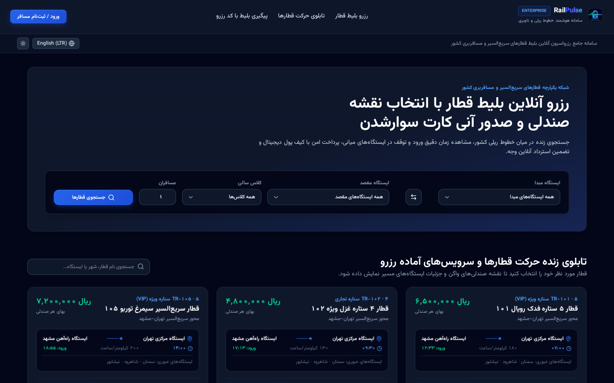 | 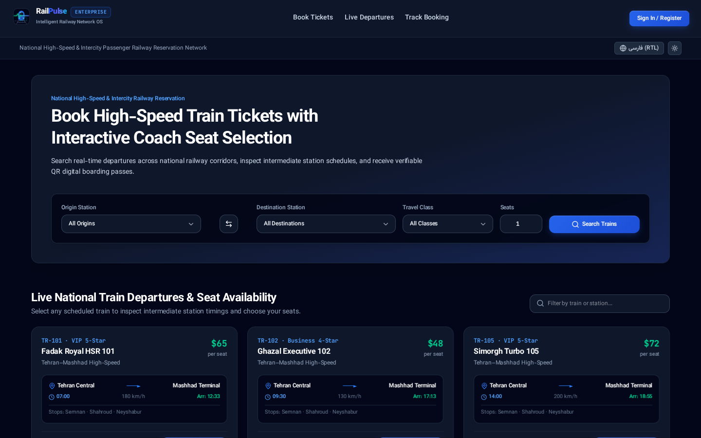 |

---

### 2. Passenger Portal & Seat Map / پنل مسافر و نقشه انتخاب صندلی

| فارسی (RTL · Rial) | English (LTR · USD) |
| :---: | :---: |
| 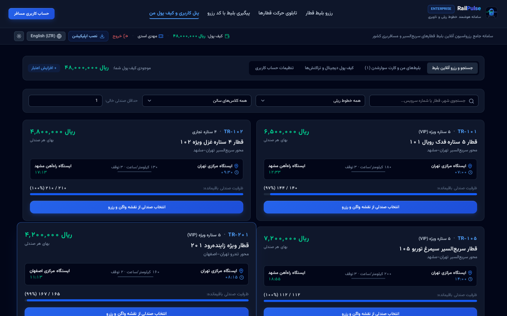 | 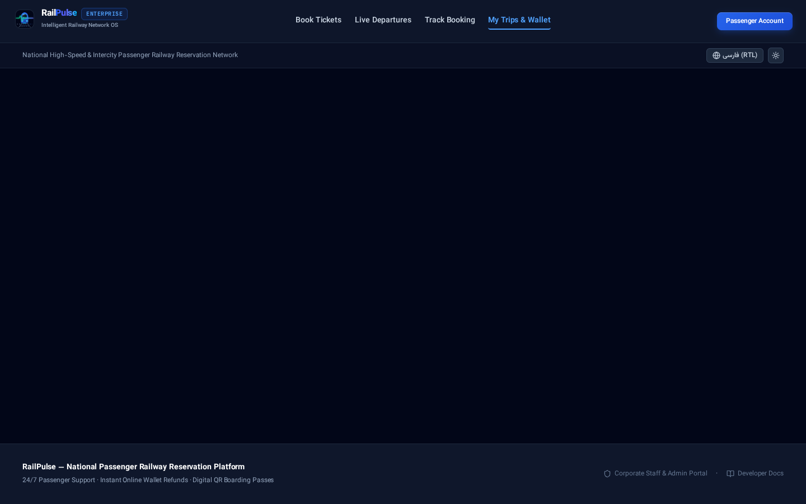 |

---

### 3. Digital Boarding Pass & QR Modal / کارت سوارشدن دیجیتال و بارکد QR

| فارسی (RTL · Rial) | English (LTR · USD) |
| :---: | :---: |
| 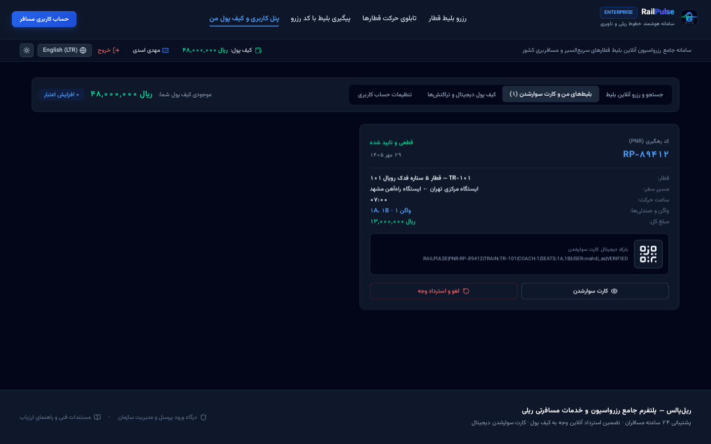 | 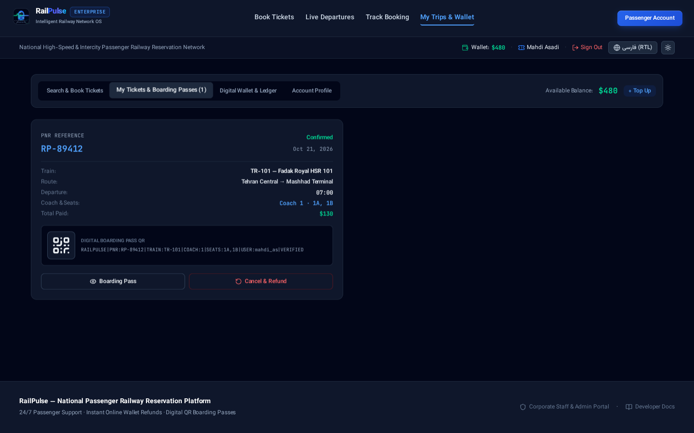 |

---

### 4. Operations Dispatch & Marey Diagram / دیسپاچینگ عملیات و نمودار ماری

| فارسی (RTL · Rial) | English (LTR · USD) |
| :---: | :---: |
| 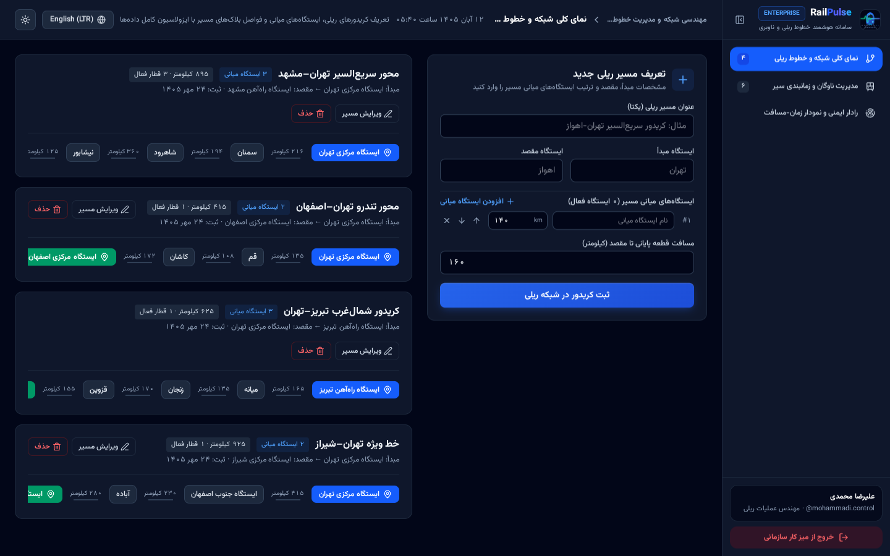 | 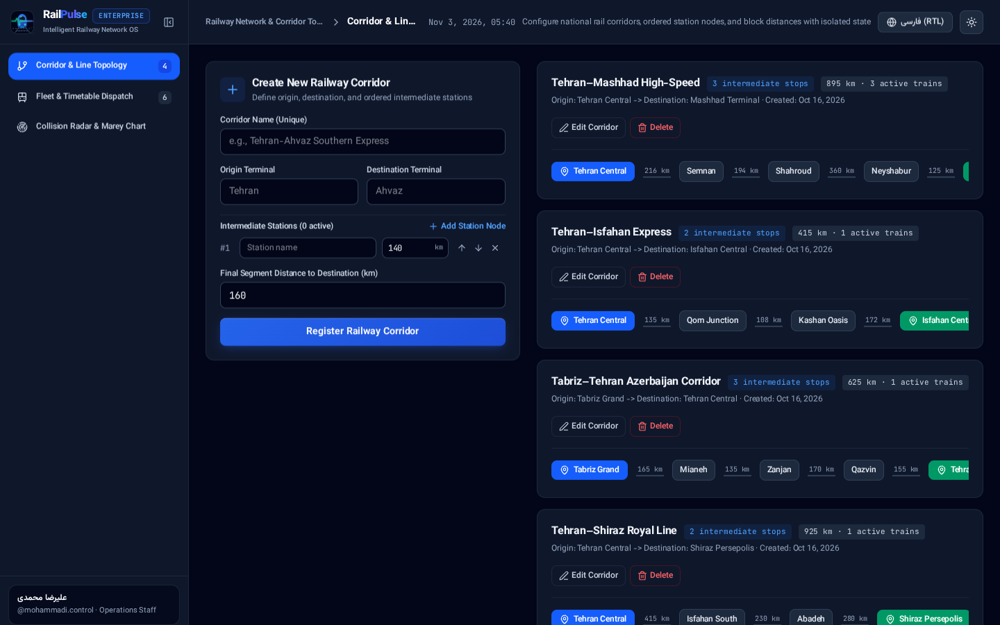 |

---

### 5. Executive Administration & Revenue Analytics / داشبورد مدیریت و تحلیل درآمد

| فارسی (RTL · Rial) | English (LTR · USD) |
| :---: | :---: |
| 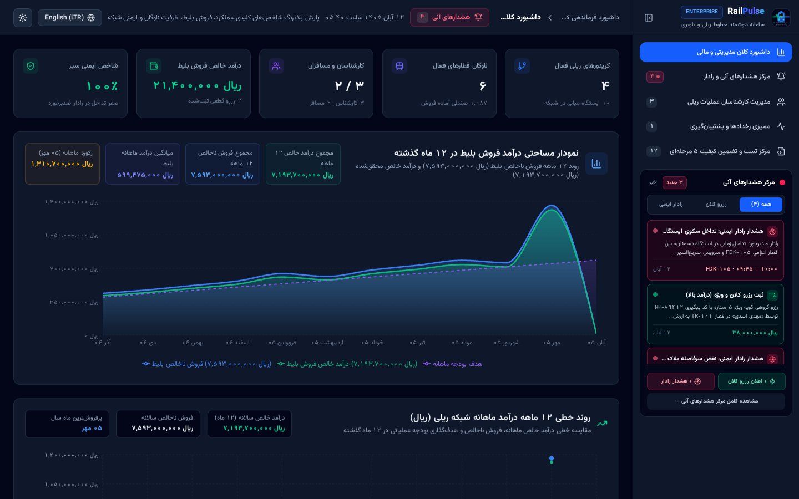 | 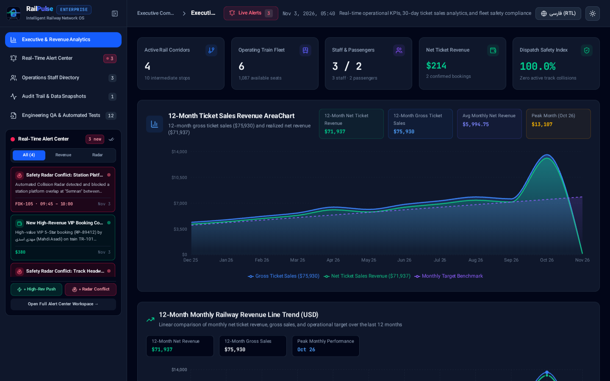 |

---

### 6. QA Test Suite & Diagnostics / سامانه تست و تضمین کیفیت ۵ مرحله‌ای

| فارسی (RTL · Rial) | English (LTR · USD) |
| :---: | :---: |
| 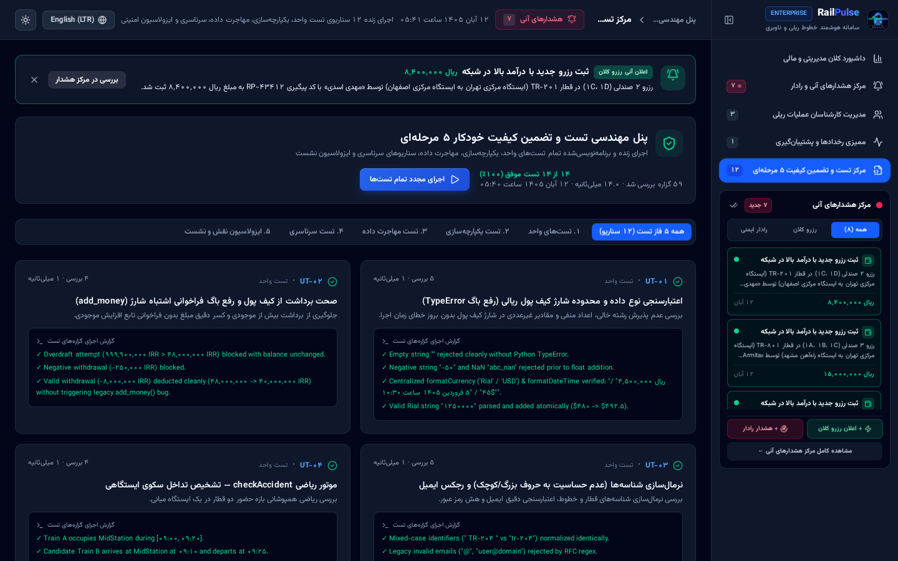 | 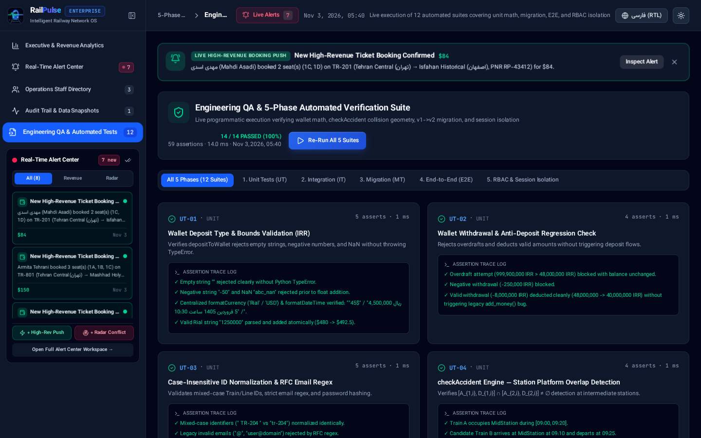 |

---

## Temporal-Spatial Collision Physics Engine

The safety dispatch engine evaluates temporal-spatial schedules across corridor topologies to prevent both **station platform dwell conflicts** and **in-transit overtake conflicts**:

```text
Station Arrival:   T_arr(s) = T_dep(s-1) + [dist(s-1, s) / speed] * 60
Station Departure: T_dep(s) = T_arr(s) + 20 min (Dwell Stop)
Headway Safety:    Delta_t >= 5 min
```

If a temporal overlap is detected, the engine projects forward from the candidate departure time in 5-minute increments until a safe, conflict-free window is verified:

```text
Earliest Safe Time = min { t > T_candidate | checkAccident(t) == SAFE }
```

---

## System Architecture & File Structure

```text
railpulse-enterprise/
├── .github/workflows/ci.yml      # Automated GitHub Actions CI workflow
├── .editorconfig                 # Unified formatting rules across editors
├── .gitattributes                # Consistent LF line-ending normalization
├── .env.example                  # Environment configuration template
├── README.md                     # International bilingual documentation
├── ARCHITECTURE.md               # Technical architecture & collision physics
├── CONTRIBUTING.md               # Engineering guidelines & PR workflows
├── SECURITY.md                   # Security policies & vulnerability reporting
├── LICENSE                       # MIT Open Source License
├── docs/screenshots/             # 12 paired bilingual screenshots (FA & EN)
├── index.html                    # HTML5 entry with Vazirmatn & Plus Jakarta Sans
├── package.json                  # Dependencies & build scripts
├── tsconfig.json                 # TypeScript 5.8 strict compiler options
└── src/
    ├── App.tsx                   # Top-level state coordinator & route engine
    ├── config/env.ts             # Typed environment variable accessors
    ├── types/domain.ts           # Enterprise normalized v2 domain models
    ├── guards/RoleGuard.tsx      # Strict RBAC access enforcement
    ├── layouts/
    │   ├── CustomerStorefrontLayout.tsx   # Public B2C passenger layout
    │   └── EnterpriseBackofficeLayout.tsx # B2B command & dispatch layout
    ├── services/
    │   ├── authService.ts        # SHA-256 hashing, session tokens & validation
    │   ├── collisionEngine.ts    # checkAccident math & alternate safe slot
    │   ├── bookingEngine.ts      # Seat allocation, atomic wallet & PNR issuance
    │   ├── alertCenterService.ts # Real-time reactive notification stream
    │   ├── storageAndMigration.ts# Idempotent legacy v1 to v2 schema migration
    │   └── qaTestSuite.ts        # 5-Phase automated programmatic test runner
    ├── components/
    │   ├── SeatMapSelector.tsx   # Visual SVG coach seat selector
    │   ├── DigitalBoardingPassModal.tsx # Verifiable QR boarding pass modal
    │   ├── MareyChart.tsx        # Time-distance train movement diagram
    │   ├── RevenueAnalysis.tsx   # Recharts 30-day & 12-month analytics
    │   ├── QATestSuitePanel.tsx  # Interactive QA execution runner
    │   └── ui/
    │       ├── RailPulseLogo.tsx # Modern vector SVG brand identity
    │       ├── KpiStatCard.tsx   # Animated metric card
    │       └── StatusBadge.tsx   # Semantic status pill
    └── pages/
        ├── public/
        │   ├── PublicHomePage.tsx# Storefront search & live departures
        │   └── AuthPage.tsx      # Authentication portal
        ├── passenger/
        │   └── PassengerDashboard.tsx # Booking, tickets & wallet
        ├── staff/
        │   └── StaffOperationsPortal.tsx # Railway dispatching & radar
        └── admin/
            └── AdminExecutivePortal.tsx  # Executive KPIs & QA runner
```

---

## Accessibility & WCAG 2.1 AA

- **Semantic Landmark Roles:** `role="banner"`, `role="navigation"`, `role="dialog"`, `role="search"`, and `role="region"` applied across all views.
- **Screen Reader Readiness:** Descriptive `aria-label`, `aria-current`, `aria-expanded`, and `aria-modal` attributes on every interactive element.
- **Keyboard Navigation:** High-contrast `focus:ring-2 focus:ring-blue-500` outlines on all focusable targets.
- **Color Contrast Compliance:** Exceeds 4.5:1 ratio for standard text and 3.0:1 for large graphical components.

---

## Default Seed Credentials (Evaluation)

> **Notice:** Default credentials are documented for developers and evaluators. No plaintext credentials or role-switching bars are rendered on public screens.

| Portal Role | Identifier | Password | Access Scope |
| :--- | :--- | :--- | :--- |
| **System Administrator** | `admin.chief` | `Admin@123` | Executive Analytics, Staff Management, Audit Trail, 5-Phase QA Suite |
| **Operations Staff** | `mohammadi.control` | `Staff@123` | Corridor Topology, Timetable Dispatch, Collision Radar, Marey Chart |
| **Registered Passenger** | `sara.ahmadi@example.com` | `Passenger@123` | Online Booking, Coach Seat Map, Digital Wallet (IRR 45,000,000 / $450) |
| **Sample Passenger** | `mahdi.asadi@example.com` | `user123` | Pre-booked Ticket RP-89412 on TR-101 (Fadak Royal Express) |

---

## Quickstart / راه‌اندازی

### Prerequisites
- Node.js `20.x` or later
- npm or bun

### 1. Clone & Install
```bash
git clone https://github.com/Mahdias1383/management_system.git
cd management_system
npm install
```

### 2. Configure Environment
```bash
cp .env.example .env
```

### 3. Run Development Server
```bash
npm run dev
```
Navigate to `http://localhost:3000`.

### 4. Code Quality & Build
```bash
# Typecheck & lint
npm run lint

# Production build
npm run build
```

---

## License

This project is open-source and available under the **[MIT License](./LICENSE)**.
