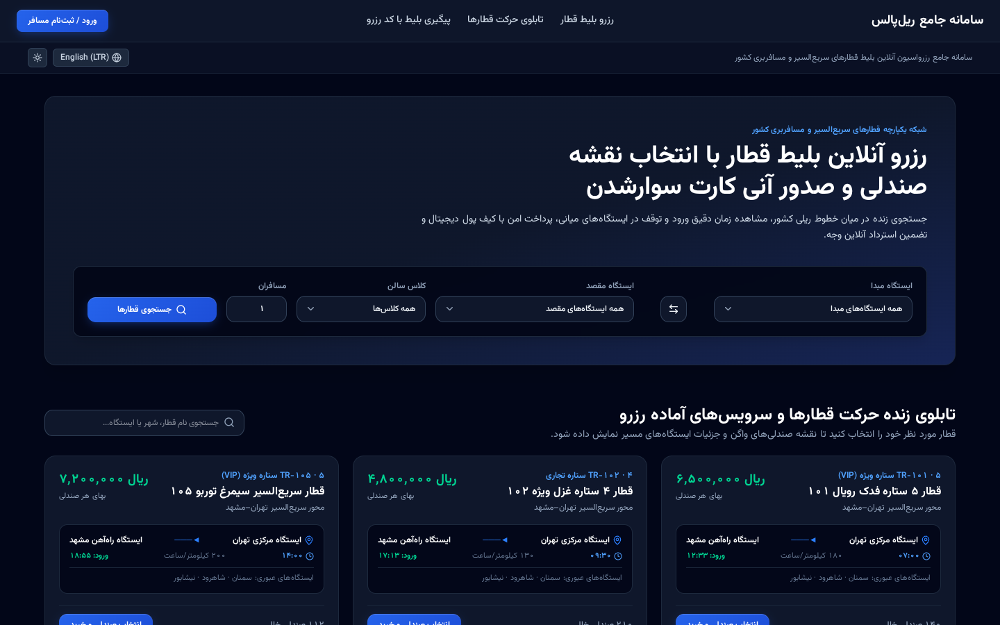
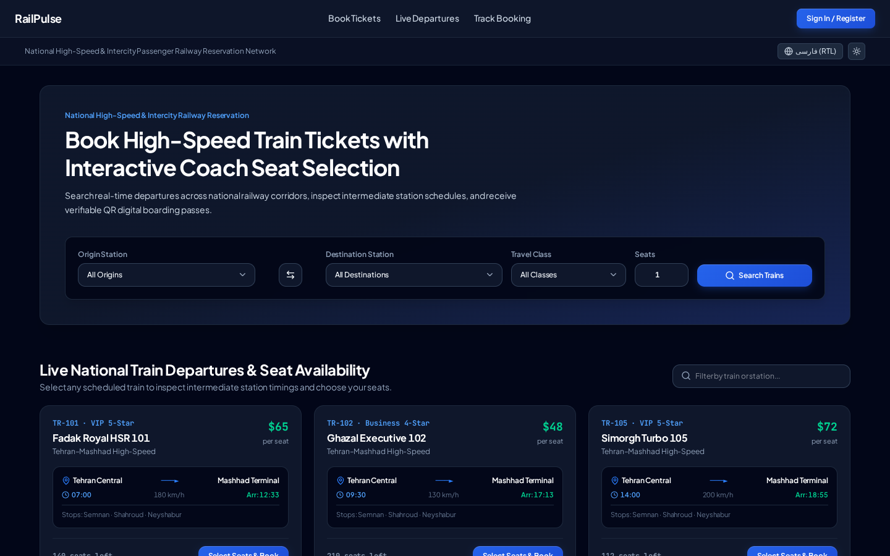
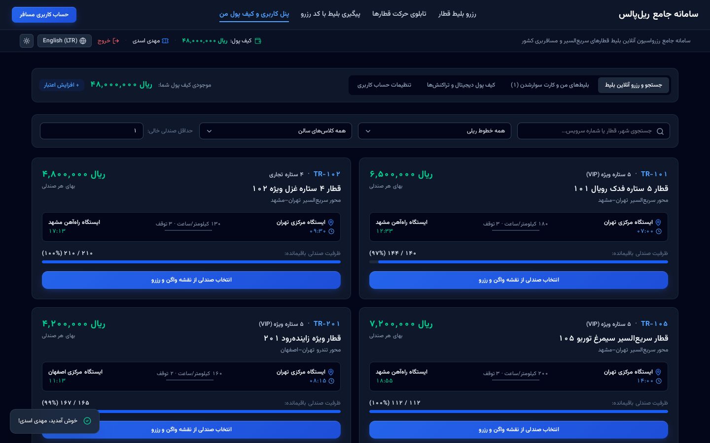
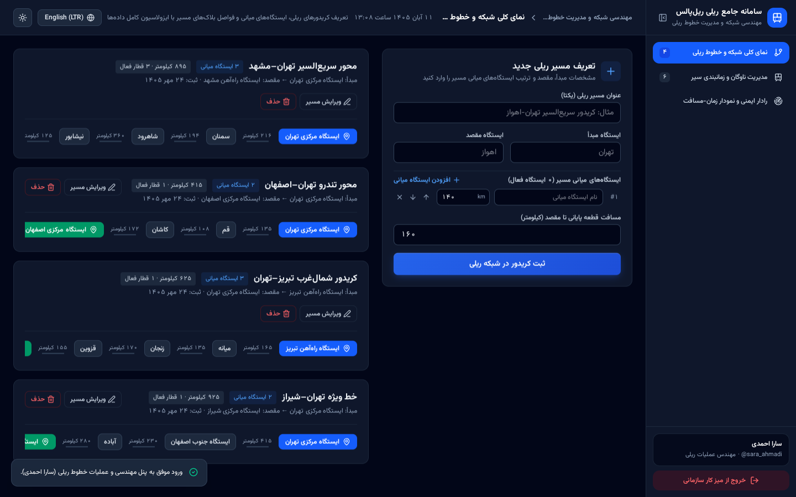
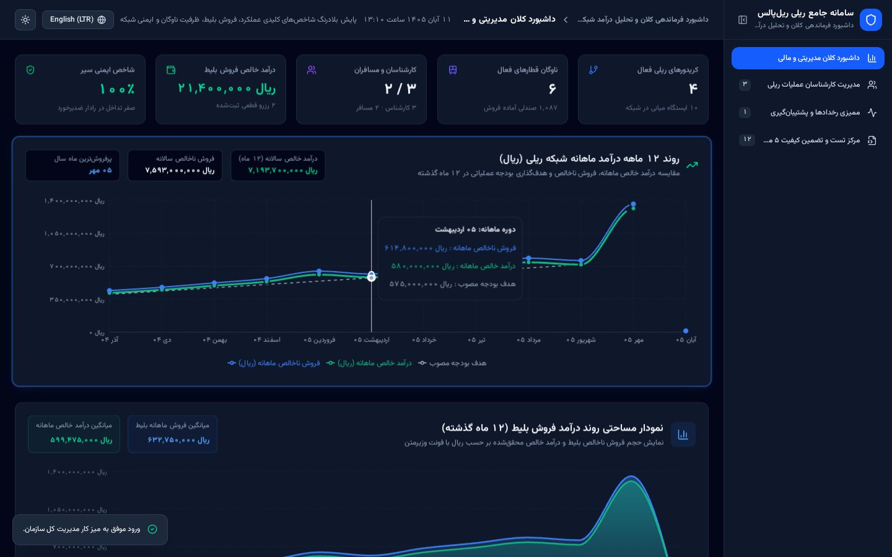
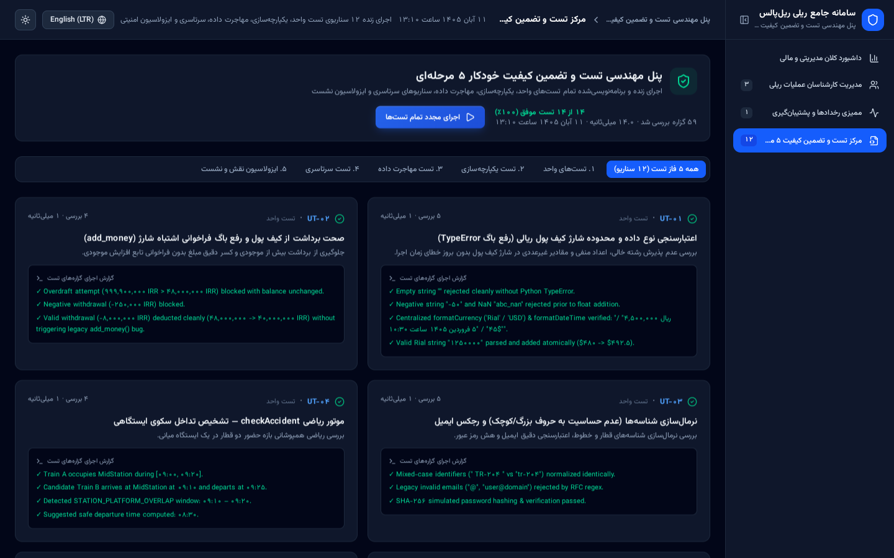
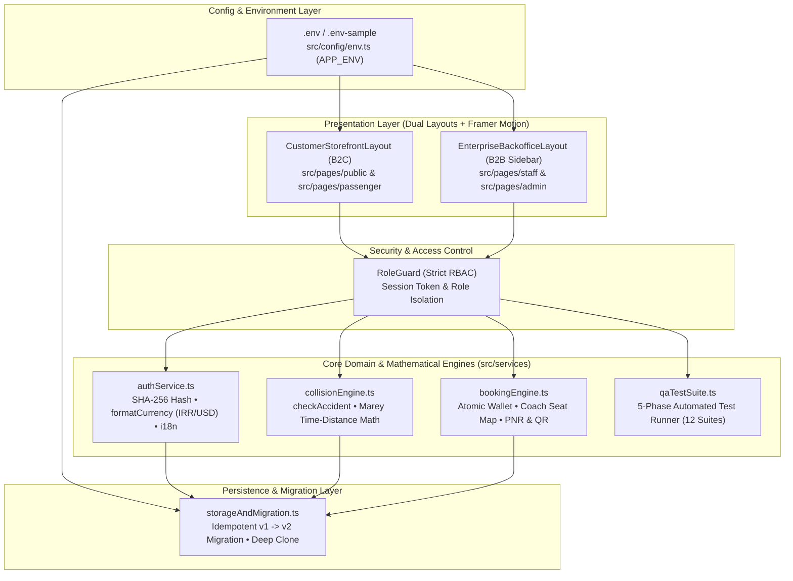

<div align="center">

# RailPulse Enterprise | پلتفرم جامع رزرواسیون بلیط و فرماندهی عملیات ریلی

**Enterprise High-Speed Railway Reservation, Corridor Topology & Temporal-Spatial Collision Prevention Platform**  
**سامانه یکپارچه رزرواسیون آنلاین بلیط قطار، مهندسی گراف خطوط ریلی و رادار ضدبرخورد زمان-مسافت**

[](./LICENSE)
[](https://www.typescriptlang.org/)
[](https://react.dev/)
[](https://tailwindcss.com/)
[](https://www.framer.com/motion/)
[](#built-in-5-phase-automated-verification-suite)

</div>

---

## معرفی جامع پروژه (Overview)

**RailPulse Enterprise** یک پلتفرم سازمانی، ماژولار و دوزبانه (**فارسی RTL با واحد ریال** و **انگلیسی بین‌الملل LTR با واحد دلار USD**) برای مدیریت هوشمند شبکه حمل‌ونقل ریلی و رزرواسیون آنلاین بلیط قطار است. این سامانه از بازمهندسی کامل یک نمونه اولیه پایتونی (`Mahdias1383/management_system`) به یک معماری وب مدرن، مقیاس‌پذیر و مبتنی بر کنترل دسترسی دقیق مبتنی بر نقش (`RoleGuard`) توسعه یافته است.

**RailPulse Enterprise** transforms a legacy Python CLI prototype into an enterprise-grade, dual-layout web platform modeled after world-class travel and operational systems (*Trainline, Eurostar, Linear, and Stripe Dashboard*). It features real-time mathematical collision prevention (`checkAccident`), interactive coach seat selection, perforated QR digital boarding passes, 12-month Recharts financial analytics, and a built-in 5-Phase Automated QA & Diagnostics runner.

---

## گالری تصاویر محیط برنامه و امکانات (Visual Product Tour)

### ۱. ویترین فروشگاهی و موتور جستجوی زنده — حالت فارسی (RTL & Rial)
> طراحی اختصاصی B2C با فونت استاندارد **Vazirmatn FD**، اعداد فارسی (`ss01`)، فرمت پولی ریال (`Intl.NumberFormat('fa-IR')`)، انیمیشن‌های نرم **Framer Motion** و استعلام آنی کد رزرو (`PNR`).



---

### ۲. رابط بین‌المللی انگلیسی — حالت چپ‌به‌راست (International English LTR & USD)
> تطبیق هوشمند جهت صفحه (`dir="ltr"`)، تایپوگرافی **Plus Jakarta Sans** و **JetBrains Mono**، اعداد انگلیسی، تاریخ میلادی و تبدیل خودکار واحد پولی به دلار آمریکا (`$ USD`).



---

### ۳. پنل اختصاصی مسافر، نقشه انتخاب صندلی واگن و کیف پول دیجیتال (Passenger Reservation Portal)
> داشبورد ایزوله مسافر شامل جستجوی پیشرفته سرویس‌ها، انتخاب صندلی از روی نقشه شماتیک واگن (`SeatMapSelector`)، شارژ و برداشت آنی کیف پول، صدور کارت سوارشدن دیجیتال QR و استرداد آنلاین بلیط با بازگشت کامل وجه.



---

### ۴. میز کار مهندسی و عملیات خطوط ریلی (Railway Operations & Dispatch Portal)
> محیط عملیاتی B2B با منوی عمودی (`EnterpriseBackofficeLayout`) ویژه مهندسان مرکز کنترل ترافیک ریلی جهت تعریف کریدورها، ایستگاه‌های میانی، زمان‌بندی ناوگان و پایش رادار ایمنی ضدبرخورد و نمودار مهندسی زمان-مسافت (**Marey Chart**).



---

### ۵. داشبورد فرماندهی کلان و تحلیل درآمد ۱۲ ماهه (System Administrator Executive Portal)
> پنل مدیریت کل سازمان شامل کارت‌های شاخص کلیدی عملکرد (KPI) با انیمیشن‌های تعاملی، نمودارهای خطی و مساحتی روند درآمد ۱۲ ماهه و ۳۰ روزه (**Recharts LineChart & AreaChart**)، مدیریت منابع انسانی کارشناسان، لاگ ممیزی (Audit Trail) و پشتیبان‌گیری JSON.



---

### ۶. مرکز تست و تضمین کیفیت خودکار ۵ مرحله‌ای (5-Phase Automated Engineering QA Suite)
> موتور تست خودکار درون‌برنامه‌ای (تعبیه‌شده در منوی مدیریت کل) که تمامی سناریوهای واحد، یکپارچه‌سازی، مهاجرت داده `v1 -> v2`، سناریوهای سرتاسری (E2E) و ایزولاسیون امنیتی نقش‌ها (`RoleGuard`) را به صورت زنده راستی‌آزمایی می‌کند.



---

## ویژگی‌ها و نوآوری‌های کلیدی (Key Features & Capabilities)

| حوزه مهندسی (Domain) | قابلیت‌ها و جزئیات فنی (Capabilities & Technical Highlights) |
| :--- | :--- |
| **معماری دولایه رابط کاربری (Dual-Layout UX)** | تفکیک کامل **`CustomerStorefrontLayout`** (ویترین روشن و کاربرپسند مسافران) از **`EnterpriseBackofficeLayout`** (میز کار عملیاتی با سایدبار عمودی ویژه کارشناسان و مدیران). |
| **بومی‌سازی دوزبانه هوشمند (Full Bilingual i18n)** | پشتیبانی کامل از **فارسی (RTL)** با فونت `Vazirmatn FD`، تقویم شمسی و واحد پولی **ریال (`IRR`)** و **انگلیسی بین‌الملل (LTR)** با فونت `Plus Jakarta Sans`، تقویم میلادی و واحد پولی **دلار (`USD`)** از طریق تابع متمرکز `formatCurrency`. |
| **موتور ریاضی پیشگیری از برخورد (`checkAccident`)** | محاسبه دقیق زمان ورود، توقف ۲۰ دقیقه‌ای در ایستگاه‌های میانی، بررسی تداخل سکوی ایستگاهی و تداخل بلاک میانی با سرفاصله ایمنی اجباری ۵ دقیقه‌ای + پیشنهاد خودکار نزدیک‌ترین زمان حرکت ایمن. |
| **نقشه صندلی واگن و کارت سوارشدن QR** | انتخاب بصری شماره واگن و صندلی (کنار پنجره / راهرو)، کسر اتمیک موجودی کیف پول، تولید کد رهگیری یکتا (`PNR`) و صدور بلیط دیجیتال قابل چاپ. |
| **امنیت و کنترل دسترسی مبتنی بر نقش (`RoleGuard`)** | ایزولاسیون کامل نشست‌ها بدون نوارهای تقلبی تغییر نقش؛ هش رمز عبور با `SHA-256`، اعتبارسنجی استاندارد ایمیل و جلوگیری از دسترسی متقاطع مسافران. |
| **مهاجرت خودکار داده (`v1 -> v2 Migration`)** | تبدیل خودکار و بدون خطای دیکشنری‌های نسخه ۱ پایتون (`user_dict`, `employee_dict`, `line_dic`, `train_dic`) به ساختار نرمال‌شده نسخه ۲ با کپی عمیق (`deepClone`). |

---

## معماری سیستم و ساختار ماژولار پروژه (Modular Repository Structure)

ساختار دایرکتوری‌های پروژه بر اساس استانداردهای مهندسی نرم‌افزار و به صورت کاملاً ماژولار طراحی شده است:

```text
railpulse-enterprise/
├── .env                          # متغیرهای محیطی محلی (ایگنور شده در گیت)
├── .env-sample                   # الگوی استاندارد متغیرهای محیطی برای توسعه‌دهندگان
├── .env.example                  # نمونه متغیرهای محیطی پروژه
├── .gitignore                    # قوانین استاندارد نادیده‌گرفتن فایل‌های حساس و خروجی‌ها
├── index.html                    # نقطه ورود HTML با فونت‌های Vazirmatn FD و Plus Jakarta Sans
├── package.json                  # وابستگی‌ها و اسکریپت‌های اجرایی
├── tsconfig.json                 # تنظیمات کامپایلر TypeScript
├── vite.config.ts                # تنظیمات باندلر Vite و پلاگین Tailwind CSS v4
├── README.md                     # مستندات جامع دوزبانه به همراه تصاویر محیط برنامه
├── ARCHITECTURE.md               # مستندات معماری، فرمول‌های ریاضی و رفع باگ‌های نسخه قدیم
├── CONTRIBUTING.md               # راهنمای مشارکت مهندسی و استانداردهای کدنویسی
├── SECURITY.md                   # سیاست‌های امنیتی، RBAC و حفاظت از داده‌ها
├── MEMORY_BANK.md                # بانک حافظه مهندسی و وضعیت فازهای ۶گانه توسعه
├── docs/
│   └── screenshots/              # تصاویر واقعی با کیفیت بالا از تمامی پورتال‌های سامانه
│       ├── 01-storefront-rtl-fa.png
│       ├── 02-storefront-ltr-en.png
│       ├── 03-passenger-portal-booking.png
│       ├── 04-staff-operations-marey.png
│       ├── 05-admin-executive-analytics.png
│       └── 06-admin-qa-test-runner.png
└── src/
    ├── main.tsx                  # نقطه اتصال React 19 به DOM
    ├── App.tsx                   # مسیریاب اصلی، مدیریت نشست، تم، زبان و انیمیشن‌های صفحه
    ├── index.css                 # استایل‌های سراسری، تنظیمات فونت و کلاس‌های انیمیشن
    ├── config/                   # ماژول تنظیمات و خوانش تایپ‌شده متغیرهای محیطی (.env)
    │   ├── env.ts
    │   └── index.ts
    ├── types/                    # قراردادهای داده و اینترفیس‌های TypeScript
    │   ├── domain.ts
    │   └── index.ts
    ├── guards/                   # گارد امنیتی کنترل دسترسی مبتنی بر نقش (RBAC)
    │   ├── RoleGuard.tsx
    │   └── index.ts
    ├── layouts/                  # طرح‌بندی‌های دوگانه B2C (فروشگاهی) و B2B (سازمانی)
    │   ├── CustomerStorefrontLayout.tsx
    │   ├── EnterpriseBackofficeLayout.tsx
    │   └── index.ts
    ├── components/               # کامپوننت‌های ماژولار دامنه و المان‌های پایه رابط کاربری
    │   ├── ui/
    │   │   ├── KpiStatCard.tsx
    │   │   ├── ToastNotificationBanner.tsx
    │   │   └── index.ts
    │   ├── DigitalBoardingPassModal.tsx
    │   ├── MareyChart.tsx
    │   ├── QATestSuitePanel.tsx
    │   ├── RevenueAnalysis.tsx
    │   ├── SeatMapSelector.tsx
    │   └── index.ts
    ├── pages/                    # صفحات تفکیک‌شده بر اساس حوزه کاربری و نقش
    │   ├── public/               # صفحات عمومی (ویترین اصلی و درگاه احراز هویت)
    │   │   ├── PublicHomePage.tsx
    │   │   ├── AuthPage.tsx
    │   │   └── index.ts
    │   ├── passenger/            # پورتال رزرواسیون و کیف پول مسافر
    │   │   ├── PassengerDashboard.tsx
    │   │   └── index.ts
    │   ├── staff/                # پورتال مهندسی عملیات و زمان‌بندی قطارها
    │   │   ├── StaffOperationsPortal.tsx
    │   │   └── index.ts
    │   ├── admin/                # پورتال فرماندهی کلان، تحلیل مالی و تضمین کیفیت
    │   │   ├── AdminExecutivePortal.tsx
    │   │   └── index.ts
    │   └── index.ts
    └── services/                 # سرویس‌های هسته منطق دامنه، موتور برخورد، رزرو و تست
        ├── authService.ts
        ├── bookingEngine.ts
        ├── collisionEngine.ts
        ├── qaTestSuite.ts
        ├── storageAndMigration.ts
        └── index.ts
```

---

## نمودار معماری سامانه (System Architecture Diagram)



---

## تنظیمات متغیرهای محیطی (Environment Variables Setup)

این پروژه از ساختار استاندارد `.env`، `.env-sample` و `.env.example` پیروی می‌کند و تمامی متغیرها از طریق ماژول تایپ‌شده `src/config/env.ts` در برنامه بارگذاری می‌شوند.

برای راه‌اندازی در محیط محلی، فایل `.env-sample` را به `.env` کپی کنید:

```bash
cp .env-sample .env
```

| متغیر محیطی (Variable) | مقدار پیش‌فرض (Default) | توضیحات (Description) |
| :--- | :--- | :--- |
| `VITE_APP_TITLE` | `"RailPulse Enterprise"` | عنوان رسمی سامانه در هدر و متادیتا |
| `VITE_APP_NAME_FA` | `"سامانه جامع مدیریت حمل‌ونقل ریلی و فروش بلیط"` | عنوان رسمی فارسی سامانه |
| `VITE_APP_VERSION` | `"2.4.0"` | نسخه فعلی انتشار سازمانی |
| `VITE_APP_ENV` | `"development"` | محیط اجرای سامانه (`development` / `production`) |
| `VITE_DEFAULT_LOCALE` | `"fa"` | زبان پیش‌فرض هنگام بارگذاری اولیه (`fa` فارسی RTL یا `en` انگلیسی LTR) |
| `VITE_DEFAULT_THEME` | `"dark"` | پوسته بصری پیش‌فرض (`dark` یا `light`) |
| `VITE_USD_EXCHANGE_RATE` | `"100000"` | نرخ مرجع تبدیل ریال به دلار در حالت بین‌المللی (`100,000 IRR = $1.00 USD`) |
| `VITE_STORAGE_KEY` | `"railpulse_enterprise_db_v2_irr"` | کلید ذخیره‌سازی پایدار پایگاه داده نسخه ۲ در مرورگر |
| `VITE_SESSION_STORAGE_KEY` | `"railpulse_active_session_v2"` | کلید نشست فعال کاربر در حافظه مرورگر |
| `VITE_ENABLE_AUTO_MIGRATION` | `"true"` | فعال‌سازی مهاجرت خودکار و تکرارپذیر از طرح‌واره پایتون نسخه ۱ به نسخه ۲ |
| `VITE_SESSION_TTL_HOURS` | `"8"` | مدت اعتبار نشست امنیتی کاربران به ساعت |
| `VITE_ENABLE_AUDIT_LOG` | `"true"` | فعال‌سازی ثبت خودکار رخدادهای مدیریتی در لاگ ممیزی |
| `VITE_COLLISION_SAFETY_BUFFER_MINUTES` | `"5"` | حاشیه ایمنی اجباری (Headway Buffer) به دقیقه در الگوریتم `checkAccident` |
| `VITE_DEFAULT_STATION_DWELL_MINUTES` | `"20"` | زمان توقف پیش‌فرض قطار در ایستگاه‌های میانی به دقیقه |
| `VITE_PNR_PREFIX` | `"RP"` | پیشوند استاندارد کدهای رزرو بلیط مسافران (مانند `RP-89412`) |

---

## راهنمای نصب و اجرا (Quick Start & Local Development)

### پیش‌نیازها (Prerequisites)
- **Node.js** `>= 20.0.0`
- **npm** `>= 10.0.0`

### دستورات نصب و اجرا (Installation & Commands)

```bash
# 1. کلون کردن مخزن
git clone https://github.com/Mahdias1383/management_system.git
cd management_system

# 2. ایجاد فایل متغیرهای محیطی از روی الگوی نمونه
cp .env-sample .env

# 3. نصب وابستگی‌ها
npm install

# 4. اجرای سرور توسعه روی پورت 3000 (http://localhost:3000)
npm run dev

# 5. بررسی صحت تایپ‌ها و لینتینگ TypeScript
npm run lint

# 6. ساخت نسخه نهایی پروداکشن (Production Build)
npm run build
```

---

## حساب‌های پیش‌فرض جهت تست و ارزیابی (Default Seed Credentials)

به منظور رعایت اصول امنیتی در محیط پروداکشن، هیچ رمز عبوری به صورت آشکار روی صفحه ورود نمایش داده نمی‌شود. توسعه‌دهندگان و داوران می‌توانند از حساب‌های پیش‌فرض زیر برای بررسی هر ۳ سطح دسترسی استفاده کنند:

| نقش سازمانی (Role) | نام کاربری (`Username`) | رمز عبور (`Password`) | مسیر ورود و امکانات حساب |
| :--- | :--- | :--- | :--- |
| **مدیر کل سازمان (`admin`)** | `Admin_train` | `admin_train` | فوتر سایت $\leftarrow$ *درگاه ورود پرسنل و مدیریت سازمان* $\leftarrow$ انتخاب «مدیر کل سازمان». دسترسی به نمودارهای ۱۲ ماهه، مدیریت کارشناسان و تستر ۵ مرحله‌ای QA. |
| **کارشناس عملیات ریلی ۱ (`staff`)** | `sara_ahmadi` | `staff123` | فوتر سایت $\leftarrow$ *درگاه ورود پرسنل و مدیریت سازمان* $\leftarrow$ انتخاب «کارشناس عملیات ریلی». مدیریت کریدورها، زمان‌بندی قطارها و رادار Marey. |
| **کارشناس عملیات ریلی ۲ (`staff`)** | `reza_karimi` | `staff123` | مهندس توپولوژی شبکه و ایمنی سیر. |
| **مسافر نمونه ۱ (`passenger`)** | `mahdi_as` | `user123` | دکمه *ورود / ثبت‌نام مسافر* در هدر بالا. دارای موجودی `۴۸,۰۰۰,۰۰۰ ریال` (`$480`) و بلیط قطعی VIP با کد رزرو `RP-89412`. |
| **مسافر نمونه ۲ (`passenger`)** | `parisa_rad` | `user123` | دارای موجودی `۲۱,۵۰۰,۰۰۰ ریال` (`$215`) و بلیط قطعی قطار تندرو تهران–اصفهان با کد رزرو `RP-90234`. |

---

## مجموعه تست خودکار ۵ مرحله‌ای (Built-In 5-Phase Automated Verification Suite)

پس از ورود با حساب **مدیر کل سازمان** (`Admin_train` / `admin_train`)، از منوی سمت راست گزینه **«مرکز تست و تضمین کیفیت ۵ مرحله‌ای»** را انتخاب کنید تا ۱۲ سناریوی تست خودکار اجرا شوند:

1. **فاز ۱ — تست‌های واحد (`UT-01` تا `UT-05`):** بررسی مبدل‌های عددی ایمن (رفع باگ `TypeError: str < int` در پایتون)، جلوگیری از برداشت بیش از موجودی، نرمال‌سازی شناسه‌ها، اعتبارسنجی ایمیل، تابع `formatCurrency` (`Rial` / `USD`) و فرمول‌های ریاضی تشخیص برخورد `checkAccident`.
2. **فاز ۲ — تست‌های یکپارچه‌سازی (`IT-01` تا `IT-02`):** زنجیره کامل تعریف کارشناس توسط مدیر $\leftarrow$ ورود کارشناس $\leftarrow$ تعریف چند خط مجزا بدون تداخل آرایه‌ها $\leftarrow$ تعریف قطار $\leftarrow$ ثبت‌نام مسافر، شارژ کیف پول و خرید بلیط.
3. **فاز ۳ — تست مهاجرت داده (`MT-01` تا `MT-02`):** بررسی مهاجرت خودکار و تکرارپذیر (Idempotent) از دیکشنری‌های نسخه ۱ پایتون به ساختار نرمال‌شده نسخه ۲.
4. **فاز ۴ — تست‌های سرتاسری (`E2E-01` تا `E2E-02`):** بررسی چرخه کامل خرید بلیط، تخصیص صندلی، صدور بارکد QR، استرداد وجه و مسدودسازی خودکار قطارهای دارای تداخل زمانی.
5. **فاز ۵ — تست‌های امنیت نقش و رابط کاربری (`UI-01` تا `UI-03`):** راستی‌آزمایی گارد امنیتی `RoleGuard`، ایزولاسیون کیف پول مسافران مختلف و صحت وضعیت دوجهته `RTL/LTR`.

---

## مجوز انتشار (License)

این پروژه تحت مجوز استاندارد **MIT License** منتشر شده است. برای اطلاعات بیشتر فایل [`LICENSE`](./LICENSE) را مشاهده نمایید.
